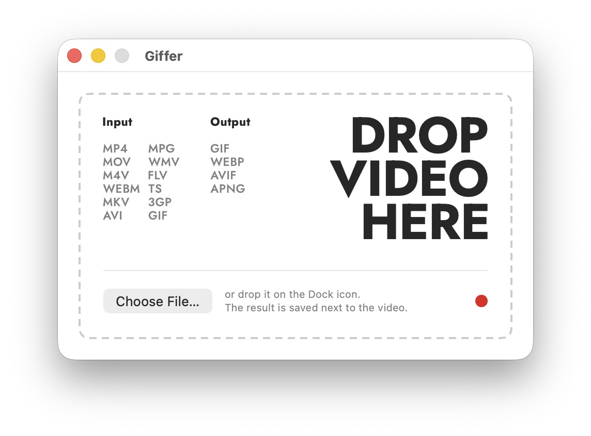
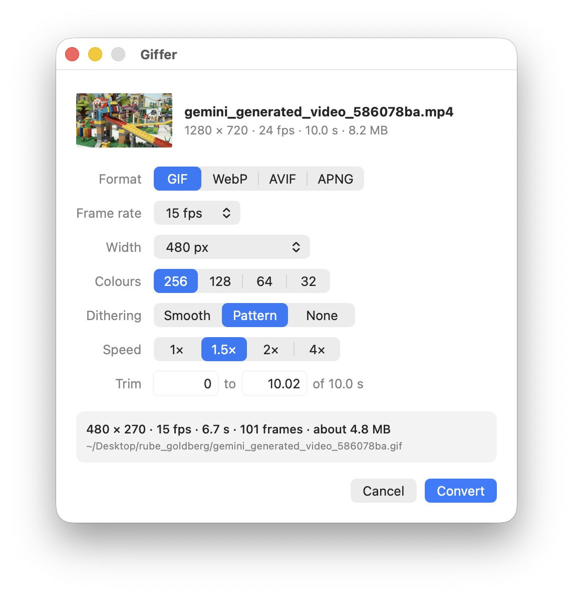

# Giffer

A small macOS app that converts a video file to an animated image: GIF, animated WebP, AVIF or APNG. It was built for making GIFs to drop into presentations such as Google Slides.

<p>
  
  
</p>

Drag a video onto the Dock icon or the app window. Tested input formats: MP4, MOV, M4V, WEBM, MKV, AVI, MPG, WMV, FLV, TS, 3GP and GIF. A settings window opens, you press Convert, and the result is written next to the source file with the same name and the extension of the chosen format.

## Download

[Download Giffer.zip](https://github.com/mgunneras/giffer/releases/latest/download/Giffer.zip) (about 40 MB). Requires macOS 14 or later, Apple Silicon or Intel. Nothing else needs to be installed; ffmpeg is included in the app.

### First launch

The app is not signed with an Apple Developer ID and is not notarised, so macOS blocks it the first time. To open it:

1. Unzip and move `Giffer.app` to Applications.
2. Double-click it. macOS shows "Apple could not verify…". Click Done.
3. Open System Settings → Privacy & Security, scroll down, and click **Open Anyway** next to the Giffer message.

This is needed once. The icon artwork is a plain square: macOS 26 rounds its corners, macOS 14 and 15 show it square. The first conversion from Desktop, Documents or Downloads may also ask for permission to access that folder.

## Settings

| Setting | Options |
| --- | --- |
| Format | GIF, WebP, AVIF, APNG |
| Frame rate | 5 to 30 fps |
| Width | Original, or 1600 down to 320 px |
| Colours (GIF) | 256, 128, 64, 32 |
| Dithering (GIF) | Smooth, Pattern, None |
| Quality (WebP, AVIF) | Low, Medium, High, Best |
| Speed | 1×, 1.5×, 2×, 4× |
| Trim | Start and end time in seconds |

The window shows the output dimensions, frame count and an approximate file size before converting. The estimate adjusts itself, per format, from the sizes of earlier conversions. All settings except trim, including the format, are remembered and used as the defaults next time.

During conversion the window shows a progress bar and a live preview. Afterwards it shows the finished animation, its size, and buttons to copy it or reveal it in Finder. If a file with the same name already exists, the app asks before replacing it.

### Formats

| Format | Extension | Notes |
| --- | --- | --- |
| GIF | `.gif` | Works everywhere. 256 colours at most, largest of the lossy options. |
| WebP | `.webp` | Lossy, full colour. Much smaller than GIF. Supported by all current browsers. |
| AVIF | `.avif` | Lossy, full colour. Smallest files. Needs a recent browser or OS (Safari 16.4 / macOS 13 or later). |
| APNG | `.png` | Lossless, full colour. Largest files. Saved as `.png` so that apps and upload forms accept it. |

For the smallest GIFs: lower the width and frame rate first, then reduce colours, and set dithering to None for screen recordings.

## Limitations

- One file at a time.
- AV1 video is not supported as input.

## Building

Requires Xcode command line tools, `gpg`, `cmake`, `pkg-config` and `nasm`.

```sh
./build-ffmpeg.sh    # once: downloads, verifies and compiles ffmpeg, libwebp and SVT-AV1 into vendor/ffmpeg
./build.sh           # builds build/Giffer.app and build/Giffer.zip
./build.sh install   # also copies the app to /Applications
```

`build.sh` signs ad hoc by default. Set `SIGN_ID` to a Developer ID Application identity to sign with it.

## How it works

The app is Swift (AppKit and SwiftUI) and runs the bundled ffmpeg. For GIF it runs twice: one pass builds a colour palette for the clip (`palettegen`), the second encodes the GIF with it (`paletteuse`). WebP (libwebp), AVIF (SVT-AV1) and APNG are encoded in one pass. Every pass also emits a small raw preview stream that the app reads for the preview image and progress.

## Third-party software

Release builds include the following, built unmodified from the official sources with the configuration in `build-ffmpeg.sh`. The licence texts are in the app at `Contents/Resources/licenses`.

| Software | Version | Licence | Source |
| --- | --- | --- | --- |
| [FFmpeg](https://ffmpeg.org) | 9.0.2 | GNU LGPL 2.1 or later | <https://ffmpeg.org/releases/ffmpeg-9.0.2.tar.xz> |
| [libwebp](https://developers.google.com/speed/webp) | 1.6.0 | BSD 3-Clause | <https://storage.googleapis.com/downloads.webmproject.org/releases/webp/libwebp-1.6.0.tar.gz> |
| [SVT-AV1](https://gitlab.com/AOMediaCodec/SVT-AV1) | 4.3.0 | BSD 3-Clause Clear | <https://gitlab.com/AOMediaCodec/SVT-AV1/-/archive/v4.3.0/SVT-AV1-v4.3.0.tar.bz2> |

The icon is set in [Jost](https://github.com/indestructible-type/Jost) (SIL Open Font License 1.1). The font file and its licence are in `assets/fonts`.
